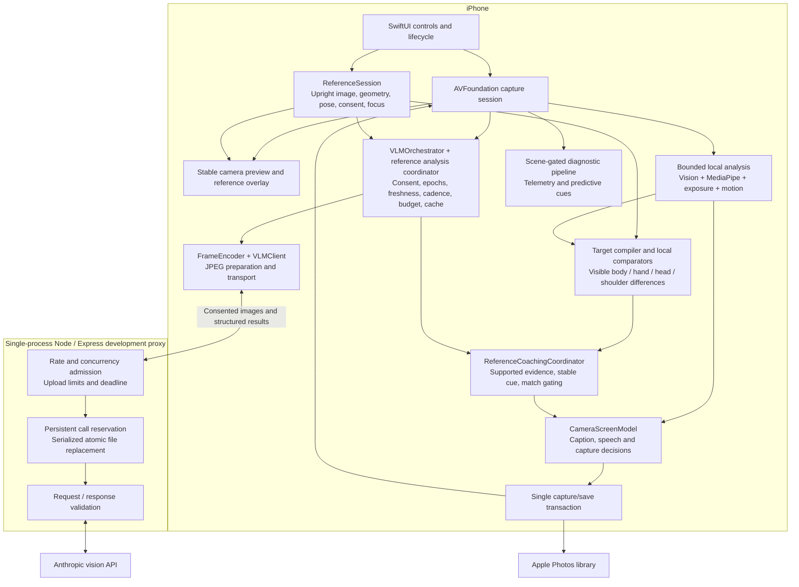

# PicPal: architecture, decisions, and interview notes

Living document. Last updated: **2026-09-28**. Implementation baseline: `e8582cf` on `codex/specific-pose-feedback`.

This is the current architecture overview and decision index. Older review reports describe historical snapshots; their findings and test counts are not necessarily current. Decisions below consolidate the recorded engineering work, rather than claiming to reconstruct every original motivation. Update this document alongside meaningful implementation changes.

## The project in 60 seconds

> PicPal is a native iPhone camera coach that helps someone recreate a reference photo. It measures visible body, face, and hand geometry on the phone for immediate guidance, and optionally uses a cloud vision model to assess broader qualities such as viewpoint, lighting, and background. A deterministic coordinator decides which instruction is supported, keeps it stable, and rejects stale results after the user changes the camera or reference. The difficult parts were getting coordinate systems and asynchronous state right, handling cropped selfies without inventing missing pose information, and distinguishing a useful partial correction from a complete reference match.

For interviews, describe your actual contribution and use of coding agents accurately. This document supports explaining the design; it is not a claim that every component was written unaided.

## Product requirements that shape the architecture

- The preview and manual shutter must work without cloud service access.
- A selfie may contain a face and fingers but no hips, legs, or reliable wrist landmark.
- A reference can be portrait, landscape, mirrored, or differently cropped from the preview.
- Coaching should identify one actionable adjustment, avoid oscillating, and acknowledge measured progress.
- Camera flips, rotation, zoom, reference replacement, and consent changes must invalidate incompatible evidence.
- The user controls uploads. Cloud access also has explicit cost and resource bounds.
- Partial pose agreement must not imply that lighting, background, viewpoint, and the whole reference match.

## System map

The arrows show logical data flow. Analysis runs asynchronously; the camera does not wait for cloud inference.

There is no application database or server-side job queue. The small quota ledger is operational state, not a user-data store. The secondary diagnostic pipeline remains separate from the primary visible coaching path; its timings must not be presented as end-to-end user latency.

## Component responsibilities and source map

| Component | Responsibility | Source |
| --- | --- | --- |
| Composition root | Connect camera delegates, app lifecycle, local analysis and cloud context | [ContentView+Session](../picpal/Sources/App/ContentView+Session.swift) |
| Screen model | Coordinate hardware controls, visible decisions and photo transactions | [CameraScreenModel](../picpal/Sources/App/CameraScreenModel.swift) |
| Camera | Manage capture session, active input and hardware behavior | [CameraCapture](../picpal/Sources/Camera/CameraCapture.swift) |
| Reference state | Extract reference evidence and own the selected focus | [ReferenceSession](../picpal/Sources/Reference/ReferenceSession.swift) |
| Coordinate contract | Transform reference/image/display coordinates | [ReferenceGeometry](../picpal/Sources/Reference/ReferenceGeometry.swift) |
| Body tracking | Shared reference/live body-tracking abstraction | [ReferenceBodyTracker](../picpal/Sources/Landmarks/ReferenceBodyTracker.swift) |
| Selfie tracking | Preserve face/hand measurements and confidence independently | [SelfiePoseTracker](../picpal/Sources/Landmarks/SelfiePoseTracker.swift) |
| Detail measurements | Validate available evidence and derive normalized features | [PoseDetailMeasurement](../picpal/Sources/Reference/PoseDetailMeasurement.swift) |
| Target and comparison | Compile measurable targets and rank specific corrections | [PoseTargetCompiler](../picpal/Sources/Reference/PoseTargetCompiler.swift), [PoseDetailComparator](../picpal/Sources/Reference/PoseDetailComparator.swift) |
| Coaching policy | Combine evidence, retain cues, enforce freshness and capture eligibility | [ReferenceCoachingCoordinator](../picpal/Sources/Reference/ReferenceCoachingCoordinator.swift), [ReferenceCoachingPolicy](../picpal/Sources/Reference/ReferenceCoachingPolicy.swift) |
| Cloud lifecycle | Schedule requests, invalidate obsolete work, account for transport | [VLMOrchestrator](../picpal/Sources/VLM/VLMOrchestrator.swift), [ReferenceAnalysisCoordinator](../picpal/Sources/VLM/ReferenceAnalysisCoordinator.swift) |
| Development backend | Bound requests and spending; keep provider credentials off the phone | [Proxy guide](../proxy/README.md), [app.js](../proxy/app.js), [resources.js](../proxy/resources.js) |
| Evaluation | Validate private datasets, replay native analysis, score final decisions | [Benchmark guide](../evals/pose-feedback/README.md) |

## How a reference becomes useful guidance

1. **Normalize the reference.** Render its image orientation and mirroring into upright pixels. Detect associated subjects and extract available face, body, and hand evidence. Portrait/landscape labels describe displayed dimensions, not inferred historical camera posture.
2. **Choose comparable geometry.** A face-only reference uses face framing; references with body evidence use person framing. Use the same display transforms for the overlay and target coordinates. Never compare a face rectangle directly with a body rectangle.
3. **Compile supported targets.** Derive face-relative hand position, finger spread, hand angle, head tilt/turn, and shoulder angle where measurements are available. Missing evidence remains unknown independently for each detail.
4. **Observe live frames with backpressure.** Body/subject sampling is bounded at 3 Hz and drops work while busy. This avoids an ever-growing queue of frames that would already be obsolete when processed.
5. **Compute concrete differences.** Compare normalized positions and aspect-corrected angles; wrap angular differences. A candidate's error is divided by its tolerance and weighted by its confidence for ranking. These confidences are detector-quality values, not calibrated probabilities of correctness.
6. **Choose one stable instruction.** Retain a supported active detail unless a competing candidate is sufficiently stronger (replacement ratio 1.35), alongside the coordinator's stability checks. Instructions are deterministic for measurable differences rather than newly invented prose each frame.
7. **Verify the same detail.** Measure whether the correction has reduced the relevant difference. Unknown selected details cannot silently become completed details. A focus change clears old progress and cloud context without unnecessarily changing camera geometry.
8. **Keep capture eligibility separate.** A correct hand or head is not a full reference match. Full-reference capture requires fresh supported evidence across applicable framing, pose, viewpoint, lighting, and background dimensions, plus local stability and capture safety. Local-only reference guidance cannot authorize it.

Face-domain details and explicitly selected detail groups can be coached despite framing mismatch. **Default All mode still prioritizes framing for person-domain references.** Independence from framing is therefore not universal.

## Decision log

The IDs are stable anchors for future discussion. “Revisit when” records a trigger, not a committed roadmap.

| ID | Decision and reason | Tradeoff / alternative | Revisit when |
| --- | --- | --- | --- |
| D01 | Native SwiftUI + AVFoundation for direct camera, orientation, preview and capture integration | More platform-specific work than a cross-platform UI | A second platform becomes an actual requirement |
| D02 | Hybrid local geometry and optional cloud semantics | Local geometry is limited; cloud adds cost, latency and privacy decisions. A cloud-only loop would make simple adjustments network-dependent | Real benchmark identifies which component needs improvement |
| D03 | Use pretrained MediaPipe Pose Landmarker Lite, with Vision fallback; do not train a new pose model initially | Crops/occlusion remain hard; fallback backend results cannot safely be treated as interchangeable | Labeled failures establish a detector limitation |
| D04 | Track partial details independently instead of requiring a complete skeleton | More availability states and policy complexity; fewer confident-looking but unsupported cues | Coverage can be improved without increasing wrong instructions |
| D05 | Compare normalized geometry and use deterministic correction templates | Limited semantic vocabulary; cannot infer palm direction, hidden joints or depth | New validated measurements justify richer wording |
| D06 | Separate face/person framing and preserve anatomical identity through mirroring | Coordinate handling becomes explicit and test-heavy | Adding a new camera mode or tracking backend |
| D07 | Keep one stable preview subtree across portrait/landscape layouts | Adaptive layout must preserve view/session identity | A major camera UI redesign |
| D08 | Publish camera-switch state after the actual input change; gate analysis and invalidate geometry | Brief transition concealment; queue drain does not prove the first displayed frame is new | Physical tests show remaining switching artifacts |
| D09 | Manual zoom uses supported hardware range and display magnification; overlay opacity is independent | Cannot manufacture a wider field of view or promise parity with Apple's Camera app | Hardware formats or product requirements change |
| D10 | Store session/generation/geometry identities and reject stale asynchronous results | Some expensive results are discarded intentionally | Improving scheduling can reduce waste without weakening correctness |
| D11 | Keep unknown, different, matched and not-applicable distinct | More conservative readiness than a single similarity score | Real labeled evidence supports changing policy |
| D12 | Rank supported corrections and add hysteresis rather than rapidly switching to each frame's winner | Stable guidance may briefly retain a less severe correction | Human-following clips show excessive delay or oscillation |
| D13 | Charge network attempts, not cache deliveries; prepare consented reference profiles without a live frame | More explicit accounting/lifecycle state | Multi-user billing requires a shared accounting service |
| D14 | Reuse a rendering context and memoize consented reference JPEGs | Cache invalidation is essential on replacement/revocation; cancellation is not memory erasure | Memory profiling reveals a better lifecycle |
| D15 | Bound proxy concurrency before allocating multipart uploads; reject excess work rather than queue it | A busy client receives 503 and must retry later | A hosted workload justifies a bounded job queue |
| D16 | Reserve quota durably enough for development before upstream dispatch; fail closed on ledger errors | Canceled/crashed requests may conservatively consume reservations; file replacement is not fsync durability or multi-process locking | Public hosting / multiple instances |
| D17 | Keep capture and save serialized, retaining a failed photo for retry | Slower bursts, one photo retained in memory; no durable crash recovery guarantee | Faster burst capture becomes a requirement |
| D18 | Evaluate real reference/live pairs and clips before training | Collection and annotation take work; synthetic tests cannot answer perception accuracy | Benchmark results isolate recognition versus geometry/policy failures |
| D19 | Add Hand / Head / Shoulders / All focus without relaxing whole-match checks | Selected unknown details may prevent a completion acknowledgement | User studies justify different focus semantics |

## Concurrency, freshness, and cost

Local queues keep work bounded rather than processing every captured frame. Geometry changes reset tracking history, and outdated observations cannot be reused merely because their inference finished successfully. The UI and visible decision handling use the main actor; camera and analysis work have their own execution contexts.

Cloud results carry enough context to reject a response for a replaced reference, revoked consent, changed geometry, or expired observation. The current policy allows comparison evidence for 8 seconds from capture and local evidence for 1 second; reference alignment requires a 1.5-second dwell. These are policy constants, not measured latency guarantees.

New cloud analyses/reference dispatches have an 8-second minimum cadence. Armed reference capture can renew at that cadence, approaching 7.5 requests/minute; unarmed unchanged scenes use a sparse 20-second refresh. The older three-calls/minute goal is not a hard cap. Generic retries have an explicit 1-second then 2-second backoff exception and each attempt spends quota; reference requests have no automatic retries.

The client budget is 50 calls per budget instance. The development proxy has a persistent shared 200-call ceiling, four admitted requests globally, 20 requests/minute/IP, at most two 5 MB uploads, and a 30-second total request deadline. Disconnects and deadlines propagate cancellation, but cannot undo provider work already accepted. Cached guidance does not spend network quota.

These bounds favor predictable resource use over maximum throughput. The proxy is intentionally a development service, **not an authenticated production backend**. Public deployment would require authentication, per-user quotas, shared atomic accounting, operational monitoring and abuse controls.

## Engineering stories worth discussing in an interview

### A peace-sign selfie exposed the wrong abstraction

The user could see a person and a hand, but a body-first system could still report that pose was unavailable. In the recorded still-image diagnostic, the wrist confidence was about 0.18 while index/middle knuckles were about 0.59/0.56. Requiring the wrist discarded useful evidence. The implementation preserves independent detail quality and can use supported knuckles for hand placement while leaving complete gesture recognition unknown. Local measured candidates use a 0.5 quality floor; the separate cloud-support threshold remains 0.65. This was not achieved by inflating confidence.

**Lesson:** choose evidence requirements per task. “Cannot verify a complete gesture” and “cannot tell where the hand is” are different states. See [selfie evaluation](selfie-pose-coach-evaluation.md).

### Rotation logs were correct while the screen was wrong

Device logs showed portrait/landscape transitions, but the user's screenshot showed a black, clipped preview. Separate portrait/landscape view branches recreated the preview owner, and unconstrained overlay layout distorted its bounds. A stable preview subtree with explicit fitted dimensions addressed those issues. Rendered regression fixtures checked view identity and visible bounds across rotation.

**Lesson:** internal state transitions are not proof of visual correctness. Add assertions at the layer where the user experienced the failure. See [camera incident history](landscape-selfie-zoom-fix.md).

### A main-actor annotation did not move the notification callback

A camera notification arrived on a background queue. Its closure inherited main-actor isolation and trapped before its nested main-actor task could execute. Making the callback explicitly sendable and hopping to the main actor for UI work corrected the boundary; a real background-post regression reproduced the original crash.

**Lesson:** isolation requirements and actual callback execution context must agree. Do not assume a nested task makes the enclosing callback safe.

### Cache accounting was corrected without claiming faster inference

The previous request gate spent quota before cache lookup. Separating eligibility from actual dispatch made a cache delivery cost zero network attempts, even after the network budget was exhausted. Preparing reference profiles independently removed an unnecessary live encode, and memoizing reference bytes reduced repeated work.

**Lesson:** use precise outcome claims. Tests establish eliminated encodes and corrected accounting; they do not establish lower phone temperature or lower provider latency. See [independent evaluation](architecture-improvement-evaluation.md).

### Focus exposed a state-policy bug

Selecting Head could fall back to an unrelated arm correction, or suppress a supported head cue because a person-domain reference had different framing. Regression tests reproduced both cases. The fixes isolate selected detail guidance while preserving framing mismatch and capture blocking.

**Lesson:** a UI preference changes the evidence contract and invalidation rules, not just the caption text.

## What has actually been verified

At implementation revision `e8582cf`, the recorded final run passed **848 Swift tests across 102 suites**, **17 proxy tests**, and **15 evaluation-tool tests**. The signed generic iOS Debug build succeeded. Independent review covered the specific-pose implementation and its final regressions. These results are recorded in the [execution record](superpowers/plans/2026-09-28-specific-pose-feedback-progress.md).

Coverage includes numeric geometry, mirrored directions, confidence/unknown handling, stale-result rejection, quota/resource behavior, capture gating, and rendered portrait/landscape control fixtures. Provider calls in proxy regression tests are mocked. Some earlier revisions were installed and exercised on a phone; this does not establish that the latest specific-pose revision was physically validated.

The real pose-feedback manifest currently contains **zero records**. There is no measured real-photo correction precision, coverage, human correction-success rate, device latency improvement or battery improvement for the new feature. The optional raw replay test does not evaluate photos without an external dataset. Test totals are software-regression evidence, not model-accuracy evidence.

Temporary `/tmp` logs referenced by historical reports are local artifacts and may disappear. Before relying on them in an interview or release claim, retain an appropriate test report in CI or an artifact store and associate it with its exact revision.

## Benchmark and training strategy

Start with the planned rights-cleared pilot of 100 reference/live pairs and 20 clips across at least 10 participants. Include cropped selfies, glasses, sleeves, either hand, partial fingers, background faces, different lighting, portrait and both landscapes. These are collection targets, not acquired data.

Label acceptable and forbidden final instructions, unknown details, and which details are complete. Keep connected participants, sessions and reference families in one split to avoid leakage through adjacent frames or transformed images. Replay actual pixels through the native detector/comparator/coordinator pipeline, then score the final emitted decisions rather than an isolated model output.

Measure correction precision and coverage together: an engine that always abstains can look precise but be useless. Also measure opposite-direction errors, unsupported completion/capture, cue reversals and whether following the instruction reduces the intended error. Proposed gates are documented in the [release report](../evals/pose-feedback/release-report.md); they have not been achieved on real data.

Train only after failure analysis identifies the component:

- Incorrect/missing landmarks: investigate detector choice, adaptation or training.
- Correct landmarks, wrong instruction: fix transforms, comparisons or policy.
- Correct instruction, excessive switching: adjust stability and scheduling.
- Correct geometry, poor semantic description: evaluate the cloud schema/prompt or a separately labeled semantic model.

Benchmark photos are useful first as a held-out evaluation set. Do not train on the test set, and do not expect more training images to fix a coordinate-transform bug. See the [training decision](../evals/pose-feedback/training-decision.md).

## Remaining architectural pressure points

| Area | Current limitation | Next evidence or change |
| --- | --- | --- |
| Local compute | Primary and diagnostic inference paths overlap | Measure inference duration, dropped frames, thermals; share observations or disable unused diagnostic work |
| Cloud freshness | Network time consumes the 8-second evidence window | Measure usable-evidence coverage and frame-to-response latency before changing cadence or validity |
| Perception | Occlusion, crop and viewpoint can make 2D geometry ambiguous | Collect labeled real pairs/clips; inspect failures by detail |
| Guidance policy | All/person-domain framing priority can delay detail guidance | Evaluate user outcomes before extending independence |
| Camera UX | Rendered tests cannot establish live-frame delivery or hardware gesture feel | Physical front/back, rotation, zoom and capture checks |
| Maintainability | Screen model and composition root have broad responsibilities | Extract session coordination and photo transactions incrementally, preserving test seams |
| Hosting | Single-process file ledger and unauthenticated development service | Add production identity, shared quotas and storage only when deployment requires it |
| Telemetry | Some legacy metrics represent dispatch rather than visible latency | Correlate capture, inference completion, caption, speech and save events |

## Questions to rehearse

| Interview question | Core answer |
| --- | --- |
| Why not ask a vision model for every frame? | Local measurements give immediate repeatable corrections; cloud requests have cost, consent and freshness constraints. Use cloud for broader semantics. |
| How do you prevent hallucinated guidance? | Require available evidence per detail, use deterministic geometry for local cues, validate cloud structure/support, and preserve unknown states. This reduces unsupported output; it does not prove zero errors. |
| How do you handle races? | Carry session/generation/geometry identities through asynchronous work and reject results from obsolete contexts. Cancel work too, but do not rely on cancellation alone. |
| Why a stateful coordinator? | Guidance must stay stable over time and verify progress; a frame-by-frame maximum score would oscillate. |
| How would you scale it? | Keep local analysis on the phone; replace development admission/accounting with authenticated per-user budgets and shared atomic state, then load-test real traffic. |
| What improved? | Cache hits no longer consume quota, unnecessary encoding was removed, proxy resources are bounded, and supported detail cues survive relevant crop/focus cases. Distinguish deterministic test evidence from unmeasured real-world speed/accuracy. |
| What would you do next? | Build the real benchmark and phone measurements, classify failures, then improve the responsible layer. Avoid premature training or a broad rewrite. |

## Keeping this document current

With each meaningful architecture or product-behavior change:

1. Update the system map or flow if responsibilities/data movement changed.
2. Add a decision ID with the problem, chosen approach, tradeoff and revisit trigger. Preserve superseded decisions with a link to the replacement.
3. Add a dated entry below with the implementation commit and relevant tests/evaluation. Distinguish planned, implemented, tested and measured.
4. Refresh the limitations and interview claims. Do not replace a historical result with a new claim unless new evidence supports it.

| Date | Change | Revision / evidence |
| --- | --- | --- |
| 2026-09-24 | Architecture review and resource/accounting improvements | [Review](architecture-review.md), [implementation](architecture-fixes-implementation.md), [independent evaluation](architecture-improvement-evaluation.md) |
| 2026-09-24 onward | Body/selfie tracking, orientation, switching, stable preview layout and hardware-bounded zoom | [Tracking](reference-pose-tracking.md), [camera history](landscape-selfie-zoom-fix.md), [opacity/zoom](overlay-opacity-camera-zoom.md); accumulated in baseline `9f1342e` |
| 2026-09-28 | Specific detail measurements, focus selection, stable guidance and benchmark tooling | `e8582cf`; [execution record](superpowers/plans/2026-09-28-specific-pose-feedback-progress.md) |
| 2026-09-28 | Established this living architecture/decision/interview document | Documentation-only consolidation against `e8582cf` |
