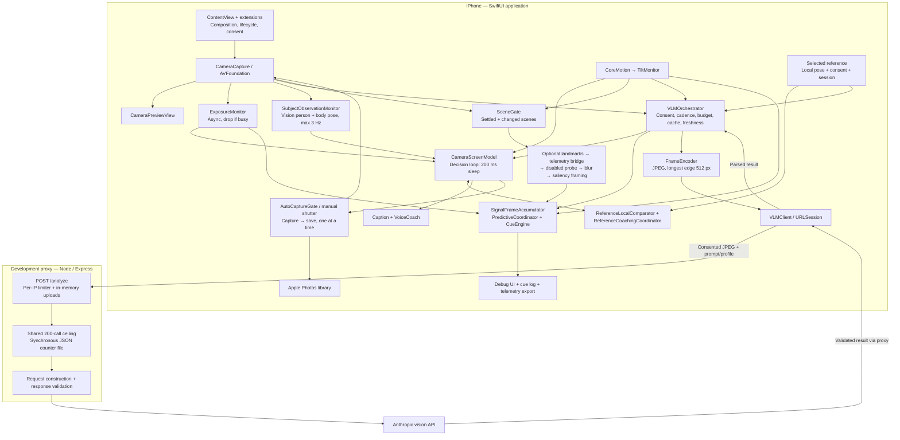

# PicPal architecture review

Reviewed September 24, 2026 against the current working tree, including uncommitted changes. This is a static code assessment, not a device profile or load test. Timing limits below come from code; actual CPU, memory, thermal behavior, and upstream latency remain unmeasured here.

## Assessment

PicPal is a native SwiftUI application with an AVFoundation camera pipeline, independent asynchronous local analyzers, and optional cloud vision behind a small Express proxy. It is a reasonable architecture for a device-first prototype: camera operation does not require the cloud, analysis queues use backpressure, and reference results are checked against consent, session identity, geometry, and age before use.

The main constraints are reference-feedback latency, limited cloud quotas, overlapping analysis paths, and incomplete end-to-end observability. The proxy remains a development service rather than a scalable multi-user backend. There is no application database or server-side job queue in the reviewed implementation.

## Architecture diagram

Arrows below represent data/control flow, not a single serial execution queue. Local inference and encoding run on worker queues; visible camera decisions run on the main actor.

The actual frame-delegate chain in `ContentView+Session.wireUp()` is Camera → Exposure → Subject → VLM → SceneGate → optional LandmarkOrchestrator → PipelineTelemetryBridge → disabled VisionLandmarkProbe → Blur → Framing. Most stages forward immediately and schedule their own asynchronous work. The diagram fans these stages out to show their logical consumers.

## Bottlenecks and improvements

### 1. Reference feedback has a narrow useful lifetime — high priority

**Evidence:** [ReferenceAnalysisCoordinator](../picpal/Sources/VLM/ReferenceAnalysisCoordinator.swift), [VLMOrchestrator](../picpal/Sources/VLM/VLMOrchestrator.swift), and [ReferenceCoachingPolicy](../picpal/Sources/Reference/ReferenceCoachingPolicy.swift).

Initial reference understanding requires a profile request followed by a comparison request. Dispatches are at least 8 seconds apart. Even if profiling finishes quickly, the first comparison must wait until that interval passes, then incur its own network/inference latency. Both operations share one busy slot and the cloud budget.

Comparison evidence expires 8 seconds after frame capture, not response arrival. A response taking 6 seconds leaves roughly 2 seconds of usable evidence. Matching also requires 1.5 seconds of stable local alignment; depending on when alignment begins, little useful time may remain. An unchanged scene without pending verification refreshes after 20 seconds, allowing roughly 12 seconds or more between evidence expiry and the next response. Scene changes can invalidate evidence sooner. These safeguards protect correctness but can make reference readiness intermittent.

**Improve:** Measure frame-to-response latency and the fraction of time with usable reference evidence. Schedule renewal before expiry when capture is armed, subject to an explicit cost policy. Prepare the profile as soon as reference consent is available, independently of waiting for a settled live frame. Preserve freshness checks rather than simply accepting older results.

### 2. Cloud quotas limit availability, and cache hits spend quota — high priority

**Evidence:** [VLMRequestGate](../picpal/Sources/VLM/VLMRequestGate.swift), [VLMSessionBudget](../picpal/Sources/VLM/VLMSessionBudget.swift), and [VLMOrchestrator](../picpal/Sources/VLM/VLMOrchestrator.swift).

The client allows 50 calls per budget instance; the server shares 200 across all callers. At a sustained request every 8 seconds, the client allocation lasts approximately 6.7 minutes; at 3 calls/minute, approximately 16.7 minutes, before accounting for retries. The 3 calls/minute target is not a hard rate cap.

In the generic coaching path, `shouldRequest` consumes quota and updates cadence before `responseCache.lookup`. A cache hit therefore spends a call allowance without sending a request. Repeated scene revisits can exhaust cloud access prematurely.

**Improve:** Separate eligibility checks from dispatch accounting. Serve valid cached results without consuming network quota, while maintaining a separate presentation cadence. Make budget exhaustion and reset behavior explicit to users and operators.

### 3. The proxy has a shared availability ceiling and limited scaling controls — high priority before multi-user use

**Evidence:** [proxy/index.js](../proxy/index.js).

The 200-call counter is persisted to a local JSON file, so a restart does not reset it despite the error message. Every admitted request performs a synchronous file write on Node's event loop. Multiple instances would have separate or conflicting file-backed accounting rather than one reliable shared quota.

Uploads are buffered in memory, up to two 5 MB files per request, then encoded for the upstream API. The 20 requests/minute/IP limiter does not bound global concurrent upstream work; many callers or slow upstream requests can increase retained memory and API spend. There is no client authentication or explicit route-level upstream cancellation tied to client disconnect. Client timeout therefore does not itself guarantee upstream work stops.

**Improve:** For hosted use, add authenticated caller quotas, bounded global concurrency, an explicit upstream deadline/cancellation policy, and atomic shared quota accounting. Remove synchronous file writes from the request path. For local development, first correct the misleading reset message and expose actionable quota status.

### 4. Overlapping local analysis can consume the thermal budget — medium priority, device measurement needed

**Evidence:** [composition root](../picpal/Sources/App/ContentView+Session.swift), [SubjectObservationMonitor](../picpal/Sources/CameraCoaching/SubjectObservationMonitor.swift), and [LandmarkOrchestrator](../picpal/Sources/Landmarks/LandmarkOrchestrator.swift).

The primary camera model consumes person/body observations at up to 3 Hz, exposure, and motion. A second scene-gated path still runs optional landmarks, blur, saliency framing, and the predictive cue engine for diagnostics/logging. When landmarks are available, subject/body analysis overlaps across paths. Independent queues avoid serial blocking but still compete for device compute and power.

The primary model runs after a 200 ms sleep per iteration plus hardware-query time. Combined with the observation cadence, this adds scheduling delay to subject changes. Frames dropped under load keep memory bounded, but observations can then fail freshness checks and pause readiness.

**Improve:** Share timestamped observations between consumers. Make diagnostic-only inference explicitly opt-in where product behavior does not depend on it. Measure inference duration, dropped analyses, observation age, and thermal state on a physical phone before changing cadence.

### 5. Existing telemetry can hide the actual bottleneck — high priority for diagnosis

**Evidence:** [PipelineTelemetryBridge](../picpal/Sources/Telemetry/PipelineTelemetryBridge.swift) and [composition root](../picpal/Sources/App/ContentView+Session.swift).

The bridge sits after the scene gate and counts only admitted frames. Its timer ends when downstream callbacks return, while blur/framing analysis continues asynchronously. It excludes upstream subject/exposure work and network latency. Thus its FPS is neither preview FPS nor raw capture FPS, and its timing is not end-to-end analysis latency.

Cue latency is logged from the separate `CueEngine` path, while primary speech comes from `CameraScreenModel`. Logged cue latency may therefore differ from the guidance users actually hear.

**Improve:** Carry a frame/request identifier and capture timestamp through analyzer completion, policy decision, caption publication, and speech start. Report separate capture rate, analysis rate, queue/inference times, cloud latency, stale-discard rate, and capture-to-save latency.

### 6. Capture throughput includes photo-library saving — intentional tradeoff

**Evidence:** [CameraScreenModel](../picpal/Sources/App/CameraScreenModel.swift) and [AutoCaptureGate](../picpal/Sources/CameraCoaching/AutoCaptureGate.swift).

`isBusy` remains set through capture, thumbnail creation, and saving to Photos. Repeated capture has a minimum 0.8-second request interval but cannot exceed the speed of this complete operation. A failed save leaves one original photo in memory and blocks the next capture until retry succeeds. This protects the photo and bounds memory; it is a throughput limit rather than an accidental queue bug.

**Improve only if faster bursts are required:** Introduce a small bounded save queue with explicit failure handling and durable recovery. Otherwise retain the simple single-photo transaction.

### 7. Repeated image preparation is avoidable work — lower priority

**Evidence:** [FrameEncoder](../picpal/Sources/VLM/FrameEncoder.swift) and [VLMOrchestrator](../picpal/Sources/VLM/VLMOrchestrator.swift).

Every live encode creates a new `CIContext`. Reference requests re-encode the unchanged reference, and even profile-only requests encode a live frame that is then omitted from the request. The generic path also computes its scene signature twice. These are concrete redundant operations, but their cost relative to inference/network time has not been measured.

**Improve:** Reuse an appropriately isolated rendering context, cache the consented reference JPEG for the reference session, encode only the images required by the operation, and reuse the already-computed signature. Clear cached reference bytes when the reference is removed or consent is revoked.

## Maintainability

`ContentView+Session` is the composition root but also owns callback wiring, telemetry, scheduling, and cloud lifecycle details. `CameraScreenModel` combines hardware controls, photo transactions, speech cadence, reference state, and capture decisions. Meanwhile the diagnostic cue pipeline and visible coaching pipeline can evolve separately.

A focused next refactor would extract an application/session coordinator from the view and separate photo capture/save transactions from coaching policy. Keep the existing pure processors and injectable dependencies; a wholesale framework rewrite or microservice split is not justified by this code.

## Recommended sequence

1. Add end-to-end measurements and fix cache-hit quota accounting.
2. Address reference scheduling using measured latency, freshness coverage, and calls/minute.
3. Profile overlapping local inference on a phone; consolidate only the work shown to matter.
4. Before shared hosting, replace development quota/storage assumptions and bound proxy concurrency.
5. Optimize image preparation and capture throughput where measurements or product requirements justify them.

No application code was changed or runtime benchmark executed for this review. Previously reported test counts in project documents were not revalidated here.
