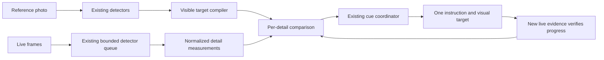

# Specific Pose Feedback Implementation Plan

> **For agentic workers:** REQUIRED SUB-SKILL: Use superpowers:subagent-driven-development (recommended) or superpowers:executing-plans to implement this plan task-by-task. Steps use checkbox (`- [ ]`) syntax for tracking.

**Goal:** Give accurate, stable, specific head/hand pose corrections against a reference, with measured improvement on real selfies.

**Architecture:** Keep Apple Vision face/hand observations and the existing body tracker. Preserve richer measurements, compile visible reference targets, compare them in normalized coordinates, and feed scored detail candidates to the existing single-cue coordinator. Evaluate the complete reference/live coaching loop before adding any trained component.

**Tech Stack:** Swift/SwiftUI, Vision, existing MediaPipe body tracker, Swift Testing, existing Node evaluation tooling; optional Core ML component only after the training decision gate.

**Spec:** `docs/superpowers/specs/2026-09-28-specific-pose-feedback.md`

## Global Constraints

- Retain on-device operation, existing cloud consent, bounded inference work, camera switching/rotation/zoom invalidation, reference opacity and native-style zoom controls.
- Do not upload user photos for training or include them in the repository.
- Missing evidence is unknown, never a match.
- Partial pose success must not enable automatic capture.
- Use preview-relative direction unless anatomical handedness is verified.
- Preserve unrelated working-tree changes. No deployment, training run, dataset purchase or collection is part of this planning task.

## Current baseline and actual gaps

`SelfiePoseTracker.swift` already extracts hand joints but reduces each hand to an anchor and optional victory Boolean. `SelfiePoseComparator.swift` already compares face-relative placement, head roll/yaw and a conservative victory gesture. Its order is fixed: hand placement, gesture, head tilt, head turn. It emits one action with a fixed confidence value.

`ReferenceCoachingCoordinator.swift` already stabilizes cues and tracks same-detail progress. `ReferenceLocalComparator.swift` already allows certain minimum-zoom selfie pose corrections despite a framing mismatch. These behaviors need extending and evaluating, not rebuilding. Existing 826 passing tests establish software regressions, not real-photo coaching accuracy.

The missing pieces are richer per-detail evidence, descriptive reference anchors, explicit target selection, calibrated thresholds/confidence, measured prioritization and a real temporal benchmark. Do not solve wording problems by retraining a landmark detector.



## Review Focus

1. Mirrored front-camera images and both landscape directions must produce the correct displayed direction (tasks 2–3).
2. A sleeve-covered wrist, cropped fingers or a hand crossing the face must produce useful independent cues or unknown, not invented gesture detail (tasks 1–3).
3. Two visible hands or background faces must not cause silent identity changes (tasks 1–3).
4. Impossible reference framing at minimum selfie zoom must not suppress all pose help or falsely enable capture (task 4).
5. Brief jitter, camera switches and zoom changes must not cause contradictory cues or stale completion (tasks 4–5).

## Task 1: Establish a real coaching evaluation baseline

**Files:** Create `evals/pose-feedback/README.md`, `manifest.schema.json`, `manifest.json`, `evaluate.mjs`, `evaluate.test.mjs`; create `picpal/Tests/PicPalTests/PoseFeedbackReplayTests.swift`; update `project.yml` only if needed for test resources and regenerate the Xcode project for new Swift files.

**Interfaces:** Manifest version 1 describes reference/live pairs or timestamped clips. The replay test runs the existing tracker, comparator and coordinator and exports JSONL decisions; Node scores those decisions against human labels. Keep detector replay and numeric-landmark replay separate.

- [ ] Define the manifest with the following record shape; paths resolve against a private local dataset root, not the repository:

```json
{
  "id": "peace-cheek-hand-low-001",
  "split": "test",
  "participantGroup": "p01",
  "sessionGroup": "s01",
  "referenceFamily": "r01",
  "referenceAsset": "references/r01.jpg",
  "liveAsset": "clips/s01.mov",
  "camera": "front",
  "orientation": "portrait",
  "mirrored": true,
  "selectedDetails": ["hand_position", "head_tilt"],
  "acceptableActions": ["hand_up"],
  "forbiddenActions": ["move_back", "show_hips"],
  "unknownDetails": ["palm_direction"],
  "rightsRecord": "consent-p01"
}
```

- [ ] Start with a proposed pilot of 100 reference/live pairs and 20 short correction clips across at least 10 consenting participants; this is a diagnostic pilot, not enough evidence to claim population-level accuracy. Include glasses, sleeves, diverse skin tones, varied lighting, cluttered backgrounds, both hands, portrait/landscape and occlusion. Include already-correct and deliberately unassessable examples.
- [ ] Label acceptable correction direction, visible details, forbidden instructions, and when a correction is completed. Use two independent annotators for held-out samples; adjudicate disagreements. Do not force one exact wording when multiple actions are useful.
- [ ] Split by participant AND connected reference/session family before calibration; keep adjacent frames and transformed copies together. Keep the user's previously debugged peace-sign example in development data, not an untouched test set.
- [ ] Write scorer tests using Node's built-in test/assert modules: acceptable action counts as correct, abstention reduces coverage, forbidden action is an error, stale completion fails, and missing replay output fails rather than disappearing from the denominator.
- [ ] Run `node --test evals/pose-feedback/evaluate.test.mjs`; verify a failing scorer test before implementing scoring. Implement manifest validation and scoring; rerun to green.
- [ ] Replay raw images/clips through the existing native pipeline and save a versioned baseline report. Export app revision, OS/device, detector configuration, orientation, zoom, timestamps and confidence provenance with decisions. Synthetic landmark tests must be reported separately.

**Deliverable:** Reproducible failure breakdown: detection, association, geometry, cue choice, wording, or temporal stability.

## Task 2: Preserve detail-level measurements

**Files:** Modify `picpal/Sources/Reference/SelfiePoseObservation.swift`, `picpal/Sources/Landmarks/SelfiePoseTracker.swift`; create `picpal/Sources/Reference/PoseDetailMeasurement.swift`; extend `picpal/Tests/PicPalTests/SelfiePoseCoachTests.swift`.

**Interfaces:** Introduce these internal types; existing public observations retain backward-compatible default fields:

```swift
enum PoseDetailKey: String, Codable, Sendable {
    case handPosition, headTilt, headTurn, fingerSpread, handRoll, shoulderTilt
}
struct PoseDetailMeasurement: Sendable {
    let key: PoseDetailKey
    let values: [Double]
    let confidence: Float
    let observedAt: TimeInterval
    let unavailableReason: String?
}
```

An unavailable detail has empty values plus a reason; it must not become numeric zero. Confidence is evidence quality, not a claimed calibrated probability until calibrated against the development set.

- [ ] Add failing tests for missing wrist with usable MCP anchors, missing fingertips with usable hand placement, low-confidence joints, nonfinite values, two-hand ambiguity, and face detection surviving a hand-request failure.
- [ ] Preserve needed joint positions/confidences from Vision instead of discarding them after the victory Boolean. Keep existing raw detected-hand count and association guards.
- [ ] Compute face-relative hand displacement, normalized index/middle spread, visible hand-axis angle and head angles. Normalize hand spread by palm width; compute angles in aspect-corrected coordinates. Reject collapsed/near-zero baselines. Shoulder tilt requires two reliable shoulders from the existing body tracker.
- [ ] Add mirrored and portrait/landscape transforms to tests; verify exactly one display-coordinate conversion. Do not infer palm-facing direction from a 2D hand-axis angle.
- [ ] Run `SelfiePoseCoachTests` and existing selfie evaluation suites before reviewing this task.

**Deliverable:** Independent measurable details remain available even when another detail is occluded.

## Task 3: Compile reference targets and specific corrections

**Files:** Create `picpal/Sources/Reference/PoseTargetProfile.swift`, `PoseTargetCompiler.swift`, `PoseDetailComparator.swift`; modify `SelfiePoseComparator.swift`, `ReferencePose.swift`; create `picpal/Tests/PicPalTests/PoseDetailComparatorTests.swift`.

**Interfaces:**

```swift
struct PoseTarget: Sendable {
    let measurement: PoseDetailMeasurement
    let tolerance: Double
    let anchorLabel: String?
}
struct PoseTargetProfile: Sendable {
    let targets: [PoseTarget]
    let selected: Set<PoseDetailKey>
}
struct PoseDetailCandidate: Sendable {
    let key: PoseDetailKey
    let normalizedError: Double
    let confidence: Float
    let action: ReferenceAction
    let target: PoseGuidanceTarget?
}
```

`PoseTargetCompiler.compile(measurements:selected:) -> PoseTargetProfile` creates only supported targets. `PoseDetailComparator.compare(profile:live:) -> [PoseDetailCandidate]` consumes the profile and `[PoseDetailMeasurement]`; the adapter preserves existing `SelfiePoseComparison` availability/alignment fields.

- [ ] Write numeric fixtures for hand low/high, head tilt either direction, too-wide/narrow finger spread, and already-aligned poses. Add translation/scale invariance, angular wraparound, mirroring, rotation and visibility tests.
- [ ] Retain current thresholds initially as baseline configuration, then calibrate detail-specific entry/exit tolerances on development/calibration data only.
- [ ] Add semantic anchors only when supported: “beside your cheek” requires reference face landmarks identifying the cheek region; otherwise use “toward the highlighted position.” Add face-landmark extraction in `SelfiePoseTracker` if the cheek anchor is included; test missing landmarks fall back to the highlight.
- [ ] Generate deterministic copy from measured direction and reference anchor: “Raise your hand toward your cheek,” “Spread your index and middle fingers slightly,” or preview-relative head-tilt instructions. Do not invent distances in centimeters or anatomical handedness.
- [ ] Keep optional cloud interpretation in existing consent/profile paths. It may identify which visible detail matters, but cannot override contradictory local measurement or manufacture a missing palm/depth target.
- [ ] Run the comparator suite and replay task-1 fixtures; inspect direction errors before accepting additional cue coverage.

**Deliverable:** Multiple individually justified correction candidates, rather than a fixed-order generic instruction.

## Task 4: Prioritize one cue and measure progress

**Files:** Modify `picpal/Sources/Reference/ReferenceLocalComparator.swift`, `ReferenceCoachingCoordinator.swift`, `ReferenceCoachingPolicy.swift`, `ReferenceAnalysis.swift`; extend `ReferenceCoachingCoordinatorTests.swift` and `SelfiePoseEvaluationTests.swift`.

**Interfaces:** Comparator candidates map to existing `ReferenceAction`/`PoseGuidanceTarget`; maintain stable action IDs per detail/direction. Existing local evidence continues to carry aligned/available detail keys, independent framing status and unknown full-pose status.

- [ ] Add timestamped sequences for noisy threshold crossings, stable correction, wrong-direction motion, disappearance, and two-hand identity ambiguity. Expected: no alternating opposite cues; no completion without newer matching evidence for the same detail.
- [ ] Rank supported candidates by user selection, confidence and error relative to tolerance. Use the existing coordinator's active/pending hysteresis; do not add a competing timer/state machine. Keep the current cue unless another is materially more useful or current evidence becomes invalid.
- [ ] Separate pose eligibility from framing alignment for supported single-person selfie evidence. Keep safety/subject-visibility failures first; distinguish a useful framing correction from an unreachable crop and avoid repeated move-back at minimum zoom.
- [ ] Preserve `framingAligned = false` on mismatched crops and `poseAligned = nil` for partial selfies. Add explicit negative automatic-capture tests for “all selected head/hand details aligned, framing different.”
- [ ] Verify camera switch, geometry revision, zoom and reference replacement reset active targets and completion. Replay the clip benchmark and compare cue reversals, reaction delay and correction success against baseline.

**Deliverable:** Stable, actionable guidance that demonstrably moves a selected detail toward the reference.

## Task 5: Optional target selection and device validation

**Files:** Modify `picpal/Sources/App/ContentView+Reference.swift`, `CameraScreenModel.swift`, `picpal/Sources/UI/ReferenceOverlayView.swift`, `picpal/Sources/Reference/ReferenceSession.swift`; extend `CameraReferenceCoachingTests.swift` and `CameraSwitchTests.swift` rendering coverage.

**Interfaces:** Store selected `Set<PoseDetailKey>` in reference-session state. Default to all confidently visible supported details; only expose available choices grouped as Hand, Head and Shoulders. A selection change invalidates coaching state, not camera geometry.

- [ ] Test selection removes unrelated cue candidates and clears prior completion, while unknown selected details remain unknown rather than silently becoming matched.
- [ ] Add a compact “Focus on” selector to reference controls; keep opacity, zoom, flip and shutter reachable. Render one target for the active cue, with accessible text and same-detail progress.
- [ ] Render real controls in portrait, both landscape directions and expanded zoom. Assert retained preview identity and visible bounds; inspect screenshots, not just test counts.
- [ ] Run the full iOS suite using the discovered simulator destination and `PicPal` scheme. Build a signed device build only after code review.
- [ ] On the phone, test the peace-sign reference, sleeves over wrist, hand near mouth, minimum selfie zoom, both landscape directions, camera flips, reference opacity zero, and cloud disabled. Record physical outcomes separately from simulation.

**Deliverable:** A usable end-to-end coach whose new controls do not regress camera behavior.

## Task 6: Decide whether training is justified

**Files:** Create `evals/pose-feedback/training-decision.md` and `release-report.md`. Only if approved after this gate, create a separate trained-component plan with dataset/model licenses, training scripts, Core ML integration and device performance tests.

- [ ] Classify remaining held-out errors. If joints are correct but cues are wrong, improve comparison/ranking/copy. If joints are missing, a landmark-only classifier cannot recover them; assess a better detector or image-crop classifier. If recognition is weak despite usable input, a small gesture classifier may help.
- [ ] Compare rules, existing detector alternatives, and a small trained candidate on identical frozen evaluation data. An image classifier needs cropped RGB training data; a landmark classifier needs labeled normalized joints. Public gesture labels alone do not train corrective instructions.
- [ ] Use only training partitions for fitting and calibration partitions for thresholds/model choice. Once held-out results influence changes, version the test set and retain a new untouched final evaluation set.
- [ ] Train only when the candidate improves the failing slice without reducing correction precision, abstention behavior, latency or battery acceptability. Export and validate on-device before integrating; never infer mobile performance from desktop metrics.

## Dataset recommendation

| Data | Best use | Limits / decision |
|---|---|---|
| Rights-cleared PicPal reference/live pairs and short clips | Main benchmark for correct instruction, direction, stability and progress | Collect consented examples; label visibility and acceptable actions; do not reuse test participants for training |
| [HaGRID](https://github.com/hukenovs/hagrid) | Supplemental peace/other-gesture recognition | Includes peace classes; landmarks are auto-annotated with MediaPipe, so they are not independent manual landmark ground truth. Review the exact dataset and model licenses before adoption |
| [FreiHAND](https://lmb.informatik.uni-freiburg.de/resources/datasets/FreihandDataset.en.html) | Hand landmark/shape research | Official terms prohibit commercial use; do not adopt for PicPal product training without separate permission |
| [InterHand2.6M](https://mks0601.github.io/InterHand2.6M/) | Later interacting-hand robustness research | More relevant to two-hand pose than the first one-hand selfie release; confirm permissions before any use |

Photos help static recognition; short clips are essential for testing contradictory cues, tracking continuity and whether following an instruction actually improves the pose. Synthetic joints remain useful for geometry tests but cannot replace real-photo detection evaluation. No datasets have been downloaded or training started.

## Proposed release gates (targets, not measured results)

- At least 90% acceptable-action precision on assessable held-out examples, with counts and participant-level uncertainty reported.
- At least 70% cue coverage on labeled assessable head/hand examples; always report precision and coverage together so abstaining on everything cannot pass.
- No opposite-direction or false full-match/auto-capture events in the curated regression suite. Report any such events separately in the real-data set.
- At least 80% of successful-following clips show reduced error for the instructed detail; review causal ambiguity rather than counting every motion as success.
- No more than one unjustified cue reversal per 10-second stable-pose clip.
- Proposed p95 measurement-to-visible-cue latency under 500 ms, and no more than 10% degradation from the measured baseline on the same phone. Measure thermal/battery behavior in repeated five-minute sessions.
- Human review confirms instructions are understandable and refer to visible details. Expand the pilot before broad reliability claims.

## Execution order and effort

Tasks 1 → 2 → 3 → 4 → 5, then the conditional training gate. Task 1 collection/annotation can continue alongside implementation once its schema and split rules are fixed. Rough engineering estimate: 8–12 working days for evaluation tooling and the untrained first release, plus data collection/annotation time. A trained component is a separate estimate after error analysis.

This is a planning deliverable. Implementation, dataset collection, model training and device installation have not been performed in this turn.
